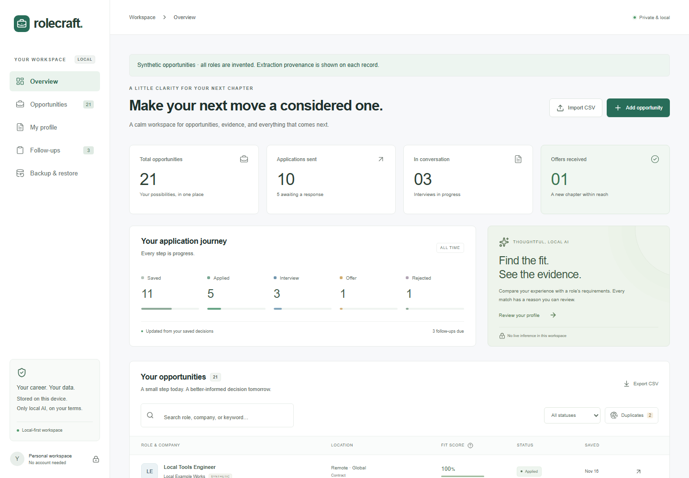

# Rolecraft · AI Job Application Tracker

A local-first workspace for organizing opportunities, inspecting résumé alignment, and tracking applications. Independent portfolio project #4 by [mubidotjs](https://github.com/mubidotjs). No existing project, database or deployment is used.

**Real local AI verification: PASS (November 15, 2026).** Ollama 0.40.16 with `qwen3:4b` (4.0B Q4_K_M) completed the committed synthetic fixture through actual local HTTP, strict Zod and exact source-evidence validation. See [metadata-only proof](docs/verification/real-ai-pass.json) and the [extraction evaluation protocol](docs/extraction-evaluation.md). Synthetic dashboard requirements still use human/demo rules and are labeled accordingly; neither those records nor mock tests establish live AI results.



Synthetic local demo. Scores shown use human/demo requirements, not verified live inference.

## Run locally

Requires **Node.js 24.x** and npm. No API key or cloud account.

```sh
git clone https://github.com/mubidotjs/ai-job-application-tracker.git
cd ai-job-application-tracker
npm ci
npm run db:seed
npm run dev
```

Open [http://127.0.0.1:3000](http://127.0.0.1:3000). SQLite is created automatically at `data/tracker.sqlite`; versioned SQL migrations run on first access. Restarting the server preserves records. `npm run db:seed` imports only the 20 synthetic fixture jobs and safely skips exact duplicates. You can instead start empty and use **Load 20 synthetic jobs** or import `public/synthetic-jobs.csv`.

For a populated, explicitly synthetic demo, **on an empty database**, run:

```sh
npm run demo:seed
npm run dev
```

This adds 20 fixture jobs, one manual example, a verified fictional résumé, human/demo requirements, and fictional tracking states. It never approves drafts or claims live inference. It refuses to modify a nonempty workspace. All fixture companies and vacancies are invented, with `example.com` URLs. The synthetic résumé contains no real person's data.

Production local build:

```sh
npm run build
npm start
```

Both servers bind to **127.0.0.1**. Do not expose this single-user application to the internet or a shared network. There is no multi-user authentication.

## Verify actual local AI

Install [Ollama](https://ollama.com/download), then in a terminal:

```sh
ollama serve
```

In a second terminal:

```sh
ollama pull qwen3:4b
npm run verify
```

Ask for authorization before downloading the model. If Ollama's desktop service is already running, skip `ollama serve`. `npm run verify` (`verify:ollama` remains an alias) first checks the local service version and model inventory, then makes one actual inference request against the first committed synthetic job. It never downloads or substitutes a model. A PASS requires HTTP 200, the exact `qwen3:4b` response identity, `done: true`, `done_reason: stop`, strict Zod output **and exact, case-sensitive source-evidence substrings**. It writes metadata only to `artifacts/ollama-verification.json` (ignored by Git): fixture ID/hash, model/digest, version, requirement count, duration, status, failure category and validation checks. It never reads your private database or saves generated requirements, source text or raw errors in that report. `UNVERIFIED` indicates an unavailable prerequisite or timeout; malformed or rejected responses are `FAIL`, with schema and evidence failures distinguished. Exit code is 0 only for PASS. Do not count a failed/unreachable call as PASS. After verification, open a job and select **Extract with Ollama** to persist and display actual inference, source quotes, model, timestamp and input hash.

Server-only defaults work without an environment file. Optional `.env.local`:

```dotenv
DATABASE_PATH=./data/tracker.sqlite
OLLAMA_BASE_URL=http://127.0.0.1:11434
```

CLI scripts read environment variables from the shell, not `.env.local`. `npm run ollama:serve` is an optional loopback-only launcher with cloud inference disabled; it never downloads models. On the verification machine it uses the authorized installation under ignored `.local-tools/ollama` and stores models in ignored `.local-models` on D:. On other machines it uses Ollama from PATH. No system-wide model-directory setting is changed. Example separate PowerShell demo database:

```powershell
$env:DATABASE_PATH = './data/demo.sqlite'
npm run demo:seed
npm run dev
```

Only HTTP loopback (`127.0.0.1`, `localhost`, `[::1]`) endpoints are allowed. Redirects, credentials, remote hosts and paths are rejected. There is no paid or external fallback. Inference is explicit, job-only, temperature 0, structured JSON, 12,000 input characters, 2,300 generated tokens, 48 KB response, 300 seconds, one in-flight request per server process. The duration bound was increased after actual CPU extraction exceeded 120 seconds; no evidence or schema checks were relaxed. The model remains probabilistic: inspect evidence and correct requirements when necessary. Strict literal validation may reject useful paraphrases; fail-closed behavior is intentional.

## Working features

- Dashboard, searchable opportunities, status and duplicate filters; responsive keyboard-accessible forms and dialogs.
- CSV file/paste import, manual jobs, edits, confirmed permanent deletion, salary and source preservation.
- Canonical duplicates blocked by normalized company/position/location/employment type **or** canonical source URL. Tracking URL parameters are stripped; listing IDs are retained. Near duplicates at the same company are flagged by title token overlap and kept until a human reviews them. **Keep both** persists a pair-specific decision.
- Pasted résumé → literal skill extraction → editable evidence contract → explicit human verification. Experience years require an exact quote with explicit numeric years and area. No inferred tenure or qualifications. Résumé extraction is deterministic local rules, **not AI**.
- Server-only Ollama/Qwen3 4B requirement extraction with strict Zod contracts, exact source quotes, priority checks, provenance and visible errors. Failed extraction preserves an earlier validated result. Editing job descriptions invalidates old extraction. Concurrent job changes reject stale inference writes.
- Transparent reproducible fit: required weight 3, preferred weight 1; evidenced matches earn full weight. Missing and unresolved weighted requirements earn 0. Unknown-priority requirements have weight 0. Unassessable constraints/responsibilities remain unknown. Explicit experience is compared by area and years. Shows each contribution, résumé quote, job quote and change history. A score measures documented alignment, **not hiring probability**.
- Manual application statuses: Saved → Applied → Interview → Offer / Rejected; users can correct any state. Dates, private notes, due/overdue follow-ups and activity history. Moving beyond Saved requires an application date. Reminders appear in the workspace; no background notifications or email.
- Short evidence-assembled cover-note templates, limited to skills matched against verified résumé quotes. These are deterministic drafts, not model-generated prose. Editing, rejection, explicit approval, approved preview, manual copy and source-change warnings. Human edits are the user's responsibility; review every claim. No sending or job submission exists.
- CSV export of all opportunities and application fields with quoting and spreadsheet-formula neutralization.
- Profile erasure also removes all drafts. Deleting a job cascades to notes, drafts and history.

## Architecture

`app/tracker.tsx` (React UI) → same-origin `app/api/tracker/route.ts` (Node runtime, strict commands, bounded bodies) → `lib/store.ts` → Node 24 `node:sqlite` (`DatabaseSync`, prepared statements, WAL, foreign keys, transactions) → local disk. Schema: jobs, profiles, drafts, events, duplicate_reviews and migration ledger. Initial migration: `migrations/001_initial.sql`.

The inference branch calls only `lib/ollama.ts` → local `/api/chat` → `qwen3:4b`. The server adds the model name and provenance; user CSV or manual contracts cannot claim Ollama provenance. Model prompts treat descriptions as untrusted data. Zod rejects extra properties, unquoted terms, fabricated numeric years, duplicates and unsupported mandatory/preferred labels. This is evidence checking, not a complete semantic proof: humans still review relevance, negation and whether each requirement is appropriate.

The browser imports only shared contracts, pure normalization and deterministic matching. Database access and endpoint configuration stay on the server. Matching is pure and covered by fixed expected-point tests. The API rejects non-loopback Host headers and cross-origin mutation requests. React escapes supplied text; no HTML rendering or source URL fetching. No trackers, external fonts, payload logging or Next.js telemetry. Browser requests stay same-origin. The local AI request contains job text only; résumé data stays in SQLite and this browser.

Bounds: 1,000 jobs, 200 CSV rows/import, 500 KB CSV, 600 KB request, 12,000 chars/job description, 16,000 chars/résumé, 6,000 chars/notes, 24 validated requirements, 60 skills, 20 experience entries, 20 drafts/job, 50 history events/job. SQLite files are **not encrypted**. Protect your OS account/device and backups. Never commit `data/`, `.env*`, model payloads, real résumés or browser test traces containing private data. Tests use synthetic data and isolated databases.

## Checks and CI

```sh
npm run typecheck
npm test
npm run build
npx playwright install chromium
npm run test:e2e
```

Vitest covers contracts, unsupported claims, matching arithmetic, CSV injection, duplicates, local endpoint policy, malformed/oversized/timed-out mock responses, persistence across connection restart, transaction rollback, stale writes and draft approval. Playwright exercises the actual UI → API → SQLite flow, CSV and manual creation, profile review, human requirements, fitting, tracking, drafts, duplicate review, delete confirmation, exports, mobile overflow and visible model-boundary failure. `data/e2e.sqlite` is test-only and reset before browser tests. CI uses Node 24 on Ubuntu and never requires Ollama or paid keys. Live inference is a separate owner-run check.

Opt-in actual local inference and evaluation, separate from CI:

```sh
npm run verify
npm run evaluate:ollama
npm run build
npm run acceptance:ollama
```

Evaluation runs only after a genuine verifier PASS. `-- --fixtures=<comma-separated IDs>` reruns affected cases while recording retained results. Live browser acceptance requires a complete evaluation with the same dataset, adapter and installed model digest, then makes its own actual job inference. It uses a new `artifacts/acceptance-<runId>.sqlite` containing only synthetic data and never opens the private workspace database. It verifies review/correction, fictional résumé evidence, score contributions, status, draft edit/approval, actual clipboard copying, CSV download and persistence after restart. Reports are metadata-only; the application database and artifacts remain ignored. A workflow PASS does not erase the evaluation's quality failures.

## Scope and remaining work

Actual Qwen3 4B inference and the [complete local browser acceptance workflow](docs/verification/live-acceptance.json) have passed. The [eight-fixture live evaluation](docs/extraction-evaluation.md) is complete and reports remaining semantic failures: final precision 88.9%, recall 85.7%, classification 87.5%, and 4/8 outputs accepted by all application checks. Numeric experience representation, negation, priority handling and missed duties still need improvement; strict rejection remains enabled. JSON editor improvements and a public portfolio demonstration remain deferred. Private records are plaintext local data; multi-user hosting would require authentication, encryption/access controls and a different deployment design.

No deployment or cloud resource is created. A hosted alternative must be a separate **explicit opt-in** and must never transmit résumé text by default. A public synthetic showcase would be labeled as such and must not claim verified live AI. The [hosted feasibility assessment](docs/hosted-assessment.md) reviews Cloudflare Workers AI's free allowance and consent requirements; it is not an enabled provider here.
